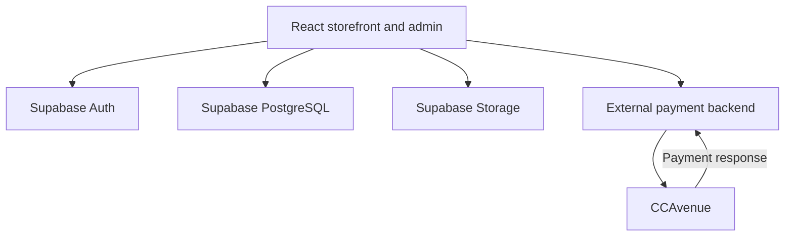

<div align="center">


# GCMT Shop

### Herbal commerce, from product discovery to order management.

A React storefront and administration workspace for **GCMT Herbal / Gold Coin Multi-Trade Private Limited**, with Supabase-powered product data, customer accounts, carts, reviews, and order records.


[Explore Features](#features) · [Run Locally](#getting-started) · [Architecture](#architecture) · [Deployment](#deployment)

</div>

---

## Overview

GCMT Shop brings the customer shopping experience and day-to-day store administration into one application. Customers can explore herbal and dental-care products, view ingredients and usage information, manage a cart, initiate a CCAvenue payment, and view their order history. Administrators have dedicated screens for maintaining products, handling orders, reviewing enquiries, and exporting newsletter subscribers.

The frontend is built with **React 19, JavaScript, React Router, and custom CSS**. Supabase supplies authentication, database access, and product-image storage. Online checkout integrates with a **separate CCAvenue backend**.

> **Repository scope:** This repository includes the React application, static assets, Supabase local configuration, and an additional payment callback Edge Function. The external payment backend, database schema migrations, and seed data are not included. See [Getting Started](#getting-started) and [Implementation Notes](#implementation-notes) before adapting it to a new environment.

## Features

### Customer experience

| Area | Implemented functionality |
| --- | --- |
| Product discovery | Homepage product highlights and a database-backed product listing. |
| Product details | Image gallery, pricing and discount display, size selection, descriptions, benefits, ingredients, usage instructions, and product sharing. |
| Shopping cart | Add products, adjust quantities, remove items, and review totals. “Buy Now” adds an item and opens checkout. |
| Accounts | Email/password registration and login, session persistence, profile information, and guest-account handling. |
| Checkout | Shipping/contact form validation, pending order creation, and CCAvenue payment initiation through an external API. |
| Order history | Customer-specific order records, payment and fulfilment status displays, order detail dialogs, and downloadable PDF invoices. |
| Reviews | Star ratings and written reviews, with edit/delete controls for the signed-in review owner. |
| Customer contact | Contact form submissions stored in Supabase and newsletter signup through the shared footer. |
| Content | About, FAQ, policy, and blog listing pages; the blog supports filtering its static entries by category and search text. |
| Presentation | Responsive layouts, mobile navigation, loading states, toast notifications, animations, and reduced-motion rules in several stylesheets. |
| Metadata | Page-specific metadata on selected routes, FAQ structured data, a sitemap, robots file, and a Google Analytics tag. |

### Administration

Admin screens check the signed-in user's `users.role` for `admin`.

| Workspace | Capabilities |
| --- | --- |
| Product manager | Create, edit, search, and delete products; maintain descriptions, prices, discounts, sizes, ingredients, and usage details. |
| Image management | Upload multiple images to Supabase Storage using file selection or drag and drop, with a 5 MB per-file limit. |
| Order management | Search orders, filter by payment/order status or date range, inspect customer and item details, change fulfilment status, and delete individual or selected orders. |
| Payment handling | Display online payment status and update payment status for existing orders identified by a `COD-` payment ID. |
| Newsletter subscribers | Search and date-filter subscribers, view summary statistics, delete individual or selected records, and export filtered results to CSV. |
| Contact enquiries | Search submissions, view message details, delete messages, and export results to CSV. |

The current checkout offers online payment. The presence of COD handling in the admin dashboard does not add a COD option to checkout.

## Technology

| Layer | Technology |
| --- | --- |
| UI | React 19.1, React DOM, JavaScript/JSX |
| Routing | React Router DOM 7.5 |
| Build tooling | Create React App / `react-scripts` 5.0.1 |
| State | React hooks, application context, and toast context |
| Authentication | Supabase Auth and `@supabase/auth-helpers-react` |
| Data and images | Supabase PostgreSQL and Storage through `@supabase/supabase-js` 2.49 |
| Payments | CCAvenue with a separately hosted encryption/callback API |
| PDF export | `html2canvas` and `jsPDF` |
| Styling and icons | Custom CSS, CSS Modules for order history, Lucide React |
| Page metadata | `react-helmet-async` |
| Test tooling | Jest through `react-scripts`, React Testing Library, and `jest-dom` |
| Additional backend code | TypeScript/Deno Supabase Edge Function |

`package-lock.json` records the resolved dependency versions. `.npmrc` enables `legacy-peer-deps` for this dependency set.

## Architecture



- **Application shell:** [`src/App.jsx`](src/App.jsx) composes the router, session provider, application context, toast provider, navigation, and footer.
- **Database access:** Pages, components, and the cart hook access Supabase through [`src/supabaseClient.jsx`](src/supabaseClient.jsx). `App.jsx` also creates a separate client for the session provider.
- **Customer state:** Account sessions persist in browser storage. Authenticated carts use `cart_items`; guest paths also use browser storage.
- **Payment boundary:** [`src/pages/CheckOut.jsx`](src/pages/CheckOut.jsx) requests an encrypted payment payload from an external backend and submits it to CCAvenue. That backend's implementation is outside this repository.
- **Additional callback code:** [`supabase/functions/verifypayment/index.ts`](supabase/functions/verifypayment/index.ts) contains a separate encrypted-response handler that updates order statuses. Its configuration and payment-ID assumptions need reconciliation before use.

## Getting Started

### Prerequisites

- **Node.js 20 or newer**, the minimum required by the locked React Router dependency.
- **npm** and **Git**.
- A development Supabase project with the application's tables, relationships, policies, and image bucket.
- A separately configured CCAvenue backend if testing online checkout.

### 1. Clone and install

```bash
git clone https://github.com/gcmt1/gcmt-vercel-webiste-vedpatel-project.git
cd gcmt-vercel-webiste-vedpatel-project
npm ci
```

### 2. Configure a development Supabase project

The current source hardcodes its Supabase URL and browser anon key in **both** of these files:

- [`src/supabaseClient.jsx`](src/supabaseClient.jsx)
- [`src/App.jsx`](src/App.jsx)

Replace those values with your development project's settings in both places. The application attempts to create guest accounts when there is no session, so configure the development connection before opening the app.

For environment-based configuration, create an ignored `.env.local` file:

```dotenv
REACT_APP_SUPABASE_URL=https://your-project.supabase.co
REACT_APP_SUPABASE_ANON_KEY=your-browser-anon-key
```

Then adapt **both** client initializers to read these variables. For example:

```javascript
const supabaseUrl = process.env.REACT_APP_SUPABASE_URL;
const supabaseAnonKey = process.env.REACT_APP_SUPABASE_ANON_KEY;
```

Use those values as the first two arguments to `createClient`, retaining the existing auth options in `src/supabaseClient.jsx`.

**Adding `.env.local` alone does not change the current connection:** the checked-in frontend does not read these environment variables yet. Restart the development server after changing environment values.

### 3. Provision the required backend resources

The database resources below are inferred from the application's queries. This is a dependency map, not a complete schema definition.

| Resource | Application use and representative fields |
| --- | --- |
| `users` | Profiles and roles: `id`, `email`, `name`, `role`, `is_guest`. |
| `products` | Catalog content: `id`, `product_name`, `product_price`, `product_discount`, descriptions, images, sizes, benefits, ingredients, and usage fields. |
| `cart_items` | Account carts: `id`, `user_id`, `product_id`, `quantity`. |
| `orders` | Customer/shipping details, `user_id`, `product_list`, `total_amount`, `payment_id`, payment/order statuses, `created_at`, and `guest_identifier` used by admin queries. |
| `product_reviews` | Product reviews: `product_id`, `user_id`, `user_name`, `rating`, `review_text`, and timestamps. |
| `contact_messages` | Customer enquiries: `name`, `email`, `phone`, `message`, and timestamps. |
| `newsletter_subscriptions` | Subscriber email addresses and timestamps. |
| Storage bucket: `product-image` | Uploaded product images and public image URLs. |

Cart queries expect a relationship from `cart_items.product_id` to `products.id`. The login cart-merge path also expects a unique conflict target on `(user_id, product_id)`.

Obtain the actual schema and access policies from the project maintainer before provisioning a new database. No SQL migrations or seed file are tracked; `supabase/config.toml` references a `seed.sql` file that is absent.

Configure database Row Level Security and Storage policies for the intended public, customer, and administrator access. Admin checks in React are UI checks; database permissions must enforce access independently, including protection of role changes and customer order data.

### 4. Start the frontend

```bash
npm start
```

Open [http://localhost:3000](http://localhost:3000).

Registration and login are available at `/auth`. To use the admin screens, sign in with an account whose profile has the `admin` role, assigned through a trusted administrative process.

## Payments

The active online checkout follows this flow:

1. Load cart items and validate the customer's shipping/contact details.
2. Insert an order with `PENDING` payment/order statuses and a generated UUID `payment_id`.
3. Send payment details to the external `/api/createOrder` endpoint.
4. Receive `encRequest` and `accessCode` from that backend.
5. Clear the cart and submit a form to CCAvenue's transaction endpoint.
6. Send the gateway response to the external `/api/paymentResponse` endpoint configured in the request.

Both external endpoints are currently hardcoded in `src/pages/CheckOut.jsx` under:

```text
https://gcmtshop-cca-backend-kappa.vercel.app
```

For another environment, update the create-order URL and both response/cancellation URLs, and configure the corresponding backend and merchant settings. Gateway credentials, encryption, callback validation, and authoritative payment updates belong on that backend.

The included Edge Function reads these server-side variables:

| Variable | Purpose |
| --- | --- |
| `SUPABASE_URL` | Supabase project URL. |
| `SUPABASE_SERVICE_ROLE_KEY` | Privileged server-side database access. |
| `CCA_WORKING_KEY` | Decryption key used by the callback implementation. |

Keep privileged keys and merchant secrets on the backend. Values prefixed with `REACT_APP_` are included in a Create React App browser build.

The active `/payment-success` page displays an order fetched from Supabase. It does not independently verify an encrypted gateway response; payment confirmation depends on the backend integration.

## Routes

### Storefront and customer pages

| Route | Page |
| --- | --- |
| `/` | Homepage |
| `/products` | Product listing |
| `/product/:id` | Product details and reviews |
| `/cart` | Shopping cart |
| `/checkout` | Shipping details and online checkout |
| `/auth` | Login and registration |
| `/profile` | Account information |
| `/your-orders` | Customer order history and invoices |
| `/payment-success` | Order summary after payment redirect |
| `/payment-cancel` | Cancellation page |
| `/about` | Company information |
| `/blog` | Static blog listing |
| `/contact` | Contact information and enquiry form |
| `/faq` | Frequently asked questions |
| `/terms-and-conditions`, `/tnc` | Policy page |

### Admin pages

| Route | Workspace |
| --- | --- |
| `/admin-landing` | Admin navigation dashboard |
| `/admin-product-manager` | Product and image management |
| `/admin-order` | Order management |
| `/admin-subscription` | Newsletter subscribers |
| `/admin-contactform` | Contact enquiries |

Unmatched paths currently render the homepage.

## Project Structure

| Path | Responsibility |
| --- | --- |
| `public/` | HTML entry point, public branding, manifest, sitemap, robots file, and hosting remnants. |
| `src/App.jsx` | Application providers, shared layout, and route definitions. |
| `src/AppContext.jsx` | Application user context and guest-account initialization. |
| `src/supabaseClient.jsx` | Shared Supabase client and session helpers. |
| `src/components/` | Navigation, footer, product cards, reviews, cart buttons, toast notifications, scrolling, and PDF invoice generation. |
| `src/hooks/useCart.jsx` | Add-to-cart logic for account and guest paths. |
| `src/pages/` | Storefront, account, checkout, payment, and admin screens. |
| `src/styles/`, `src/index.css`, `src/App.css` | Page styles, shared utilities, responsive rules, and animations. |
| `src/assets/` | Logos, product photography, promotional artwork, and the marketing video. |
| `src/utils/ccaUtils.js` | Auxiliary payment helper containing a placeholder backend URL. |
| `supabase/config.toml` | Local Supabase service and function configuration. |
| `supabase/functions/verifypayment/` | Additional TypeScript payment-response handler. |
| `vercel.json` | SPA fallback rewrite for client-side routes. |
| `test.js` | Standalone CCAvenue encryption fixture generator; separate from the React test runner. |

## Scripts and Testing

| Command | Purpose |
| --- | --- |
| `npm start` | Start the development server. |
| `npm run build` | Generate the production frontend in `build/`. |
| `npm test` | Start the interactive React test runner. |
| `npm test -- --watchAll=false` | Run the configured React tests once. |
| `npm run deploy` | Run the predeploy build and publish `build/` with `gh-pages`. |
| `npm run eject` | Eject Create React App configuration; a one-way tooling change. |

The checked-in `src/App.test.js` is the original Create React App “learn react” test. Its assertion does not match this storefront. The repository does not include application-specific integration or end-to-end tests, or a checked-in CI workflow.

## Deployment

### Vercel frontend configuration

| Setting | Value |
| --- | --- |
| Project root | Repository root |
| Framework preset | Create React App |
| Install command | `npm ci` |
| Build command | `npm run build` |
| Output directory | `build` |

[`vercel.json`](vercel.json) rewrites incoming paths to `/`, allowing `BrowserRouter` routes to load directly. This deploys the frontend; the external payment API and Supabase resources require their own configuration.

The repository's configured website address is **`https://gcmtshop.com/`**, appearing in `package.json`, CNAME files, metadata, and the sitemap. Update those references, analytics settings, auth redirect settings, and payment callback destinations when using another domain.

The `gh-pages` script and `public/404.html` reflect a separate GitHub Pages path. The current application uses `BrowserRouter`, while that fallback redirects to a hash URL; review routing before choosing GitHub Pages as the host.

## Implementation Notes

<details>
<summary><strong>Current integration details and limitations</strong></summary>

These points describe the checked-in source and distinguish the implemented UI paths from integrations that need alignment.

| Area | Current state |
| --- | --- |
| Guest sessions and carts | Guest creation exists in both `AppContext.jsx` and `AuthPage.jsx` with different identity conventions. The cart page uses `localStorage`, while the cart hook and checkout use `sessionStorage` for guest carts. These paths need a consistent storage and identity model. |
| Payment callback configuration | `config.toml` names `verify-payment` and references that directory, but the tracked function directory is `verifypayment`. The handler parses a numeric order ID, while active checkout sends a UUID `payment_id` to CCAvenue. Its decryption also differs from the standalone fixture generator. Reconcile these details before relying on this handler. |
| Alternate payment components | `src/pages/PaymentPages.jsx` contains an alternative verification flow calling `/api/verify-payment`; it is not mounted by `App.jsx`, and that API implementation is absent here. |
| Navigation | The navbar links search to `/search`, but that route is not defined. Some admin redirects and footer links retain `/login` or hash-based paths rather than the registered `/auth` and policy routes. |
| Product data consistency | Product cards resolve `product_image` as a Storage path, while the manager and detail page handle full URLs or comma-separated URLs. Displayed discounts and selected sizes also need alignment with cart/order pricing and item data. |
| UI-only affordances | Wishlist/favourite toggles use component state. The blog contains static entries and placeholder article/pagination controls; this repository does not provide a blog CMS, persistent wishlist, courier integration, or order-email sending implementation. |
| Invoice totals | PDF invoices currently calculate tax at `0`, while the template labels it “GST 18%”. Confirm the intended calculation and label before business use. |

</details>
