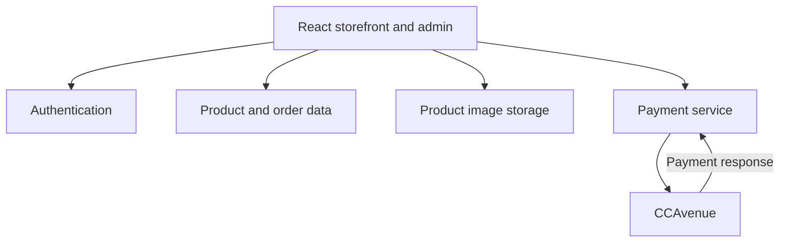

<div align="center">


# GCMT Shop

### Herbal commerce, from product discovery to order management.

A React storefront and administration workspace for **GCMT Herbal / Gold Coin Multi-Trade Private Limited**.


[Features](#features) · [Technology](#technology) · [Getting Started](#getting-started) · [Deployment](#deployment)

</div>

---

## Overview

GCMT Shop combines a customer shopping experience with dedicated tools for store administration. Customers can explore herbal and dental-care products, read product information, manage their cart, initiate online checkout, and view order records. Store administrators can maintain catalog content, manage orders, review customer enquiries, and export subscriber records.

The application uses **React, JavaScript, React Router, and custom CSS**, with Supabase for authentication, data access, and product-image storage. This source implements CCAvenue checkout through same-origin server endpoints. The public storefront bundle observed on November 23, 2026 contains a separate legacy integration. The candidate is isolated and release is blocked pending the gates in the [engineering audit](docs/engineering-audit.md).

## Features

### Customer experience

| Area | Capabilities |
| --- | --- |
| Product discovery | Homepage product highlights and a database-backed product catalog. |
| Product information | Image galleries, pricing and discount displays, size selection, descriptions, benefits, ingredients, and usage instructions. |
| Shopping cart | Add products, adjust quantities, remove items, and review totals. |
| Quick checkout | “Buy Now” opens size selection for products with variants. For a product without variants it adds one item and opens checkout. |
| Customer accounts | Email/password registration and login, profile information, and session persistence. |
| Online checkout | Shipping/contact details, form validation, order creation, and CCAvenue payment initiation. |
| Order history | Customer order records, payment and fulfilment status displays, order detail dialogs, and downloadable PDF invoices. |
| Product reviews | Star ratings and written reviews, with controls for customers to manage their own reviews. |
| Contact and newsletter | Customer enquiry submissions and newsletter signup through the shared footer. |
| Content pages | Company information, FAQs, policies, and a static blog listing with category and text filters. |
| Responsive interface | Mobile navigation, adaptable layouts, loading states, toast notifications, and animations. |
| Page metadata | Metadata on selected pages, FAQ structured data, sitemap, and robots file. |

### Store administration

| Workspace | Capabilities |
| --- | --- |
| Product management | Create, edit, search, and delete products; maintain descriptions, prices, discounts, sizes, ingredients, and usage information. |
| Product images | Upload multiple product images using file selection or drag and drop. |
| Order management | Search and filter orders, inspect order details, update fulfilment statuses, and manage selected records. |
| Payment records | View payment statuses and manage payment records for existing cash-on-delivery orders. |
| Newsletter subscribers | Search and filter subscribers, view summary statistics, manage records, and export results to CSV. |
| Contact enquiries | Search submissions, view message details, manage records, and export results to CSV. |

Customer checkout supports online payment and a separately gated cash-on-delivery path. Both default off. Its availability in a deployed environment depends on the server configuration, database migration, and payment-provider validation described in [deployment preparation](docs/deployment.md). Cash collection requires a staff identity and receipt reference. Staff archive orders while preserving their payment history.

## Technology

| Layer | Tools |
| --- | --- |
| User interface | React, React DOM, JavaScript/JSX |
| Routing | React Router DOM |
| State | React hooks and Context |
| Authentication and data | Supabase Auth and Supabase JavaScript client |
| Product images | Supabase Storage |
| Payments | CCAvenue and same-origin server endpoints |
| PDF invoices | html2canvas and jsPDF |
| Styling | Custom CSS and CSS Modules |
| Icons | Lucide React |
| Page metadata | react-helmet-async |
| Build tooling | Vite |
| Test tooling | Vitest, React Testing Library, Playwright, and isolated PostgreSQL tests |
| Server runtime | Node.js Fetch handlers on Vercel |

Dependency declarations and resolved versions are maintained in `package.json` and `package-lock.json`.

## Architecture



The application contains customer pages, shared interface components, and dedicated administration screens. Supabase provides the connected authentication, database, and storage services. The application includes same-origin server endpoints for checkout, order lookup, and payment responses. Merchant credentials and database access policies are provisioned separately.

## Getting Started

### Prerequisites

- **Node.js 24.15.0 or newer within the 24.x release line** (required by the locked test dependencies).
- **npm 11.9.0** and **Git**.
- An approved development Supabase environment with the application's data model, access policies, and image storage.
- An approved CCAvenue test configuration when developing checkout functionality.

### 1. Clone and install

```bash
git clone https://github.com/gcmt1/gcmt-vercel-webiste-vedpatel-project.git
cd gcmt-vercel-webiste-vedpatel-project
npm ci
```

The clone command retrieves the remote default branch. For this local handoff, use the reviewed `fix/gcmt-checkout-integrity` checkout or apply its verified patch to the baseline identified in the engineering audit.

The repository's `.npmrc` supplies the dependency-resolution settings used by this project.

### 2. Prepare development services

Copy `.env.example` to `.env.local` and configure an approved development Supabase project and its public key. Use development accounts and test records for local work. Configure server-only variables only when testing checkout.

```bash
cp .env.example .env.local
```

For local API requests from `http://localhost:3000`, set `SITE_URL=http://localhost:3000` in `.env.local`. The origin must match the address used in your browser; `localhost` and `127.0.0.1` are different origins. Use the canonical HTTPS origin for a deployed environment. Gateway callback testing requires a merchant-approved, externally reachable test environment; local tests do not establish payment-provider compatibility.

For an empty development database, review the opt-in bootstrap in `supabase/bootstrap/empty-project.sql` and both ordered migrations. Existing databases require the separate schema comparison in the deployment guide. Hosted Auth, Storage and merchant integration require a separate setup. Obtain those instructions through the maintainer's approved private channel.

A local frontend server can still connect to remote services. Confirm that the application points to the intended development environment before using forms, accounts, or checkout.

### 3. Start the application

```bash
npm start
```

Open [http://localhost:3000](http://localhost:3000). The development server reloads source changes and serves the local API routes. Server endpoints remain unavailable until development credentials and the database migration are configured.

## Local fixture storefront

With the locked dependencies installed, run `npm run review` and open `http://127.0.0.1:4173`. The local fixture supplies accounts and catalog rows. Leave that port free when running Playwright. Exercising checkout against real services requires separately provisioned staging credentials.

## Environment

| Variable | Purpose |
| --- | --- |
| `REACT_APP_SUPABASE_URL`, `REACT_APP_SUPABASE_ANON_KEY` | Public Supabase URL and publishable/anon key for the intended environment. |
| `REACT_APP_GA_MEASUREMENT_ID` | Optional public analytics measurement ID. |
| `REACT_APP_COD_ENABLED` | Build-time visibility of customer COD checkout. |
| `SUPABASE_URL`, `SUPABASE_SERVICE_ROLE_KEY` | Server database project and privileged key. Use the same project as the browser. |
| `SITE_URL` | Canonical origin used for same-origin checks and both gateway return URLs. |
| `CCA_MERCHANT_ID`, `CCA_WORKING_KEY`, `CCA_ACCESS_CODE` | Merchant identity, encryption secret and gateway handoff access code. The server supplies the access code only in the checkout response. |
| `CCA_ENVIRONMENT` | Select the sandbox or production gateway from the shared allowlist. |
| `SECURE_CHECKOUT_ENABLED`, `CCA_CALLBACKS_ENABLED` | Independent server gates for new online attempts and processing existing returns. |
| `STORE_COD_ENABLED` | Server permission for new COD orders. Requires separately approved storefront visibility. |
| `STORE_PRODUCTION_BRANCH` | Owner-verified production branch. Production guard also checks hosting-provided `VERCEL_ENV`, `VERCEL_GIT_REPO_OWNER`, `VERCEL_GIT_REPO_SLUG` and `VERCEL_GIT_COMMIT_REF`. |

## Troubleshooting

- **Store configuration required.** Configure the two public Supabase settings and restart or rebuild. The fixture storefront requires no real service credentials.
- **Cart changed.** Review current prices, sizes, quantities and availability. The database compares the complete quote before saving a payable snapshot.
- **Payment not confirmed.** Open order history in the same account. Support can compare the reference with the merchant and check the private review queue. A new charge requires authoritative clearance of the old attempt.
- **Invoice unavailable.** Inspect the stored total and historic line shape privately. A mismatch requires finance review.
- **Receipt tests cannot start.** The native test cluster needs a writable temporary directory and a free loopback port. Playwright also needs Chromium and port 4173.

The [payment lifecycle](docs/payment-lifecycle.md) describes pricing, handoff recovery and final settlement. The [engineering questions](docs/engineering-questions.md), [test evidence and findings](docs/engineering-audit.md), [file inventory](docs/review-scope.md) and [deployment gates](docs/deployment.md) document the review and its limitations.

## Project Structure

| Path | Purpose |
| --- | --- |
| `index.html`, `public/` | HTML entry point, public branding, manifest, sitemap, and robots file. |
| `src/App.jsx` | Application providers, shared layout, and routing. |
| `src/components/` | Navigation, footer, product cards, reviews, cart controls, notifications, and invoice generation. |
| `src/hooks/` | Reusable application hooks. |
| `src/pages/` | Storefront, customer, checkout, payment, and administration screens. |
| `src/styles/` | Page-specific styling and CSS Modules. |
| `src/assets/` | Logos, product images, promotional artwork, and marketing video. |
| `supabase/` | Database migrations and local service configuration. |
| `server/`, `api/` | Server-only checkout, payment response, and order endpoints. |
| `tests/` | Regression tests and isolated service fixtures. |
| `vercel.json` | Frontend hosting configuration. |

## Available Commands

| Command | Purpose |
| --- | --- |
| `npm start` | Start the local development server. |
| `npm run build` | Generate the production frontend in `build/`. |
| `npm run review` | Serve the storefront with synthetic local records and checkout disabled. |
| `npm run test:postgres` | Start a temporary loopback PostgreSQL cluster and test concurrent writes and rollback. |
| `npm test` | Run unit, handler, and database-policy regression tests. |
| `npm run test:watch` | Start the test watcher. |
| `npm run test:e2e` | Test the browser flow against isolated local services. |
| `npm run check` | Run the secret scan, tests, build, and runtime dependency audit. |
| `npm run format:check` | Check formatting of server, tooling, and test files. |
| `npm run check:secrets` | Scan tracked and non-ignored untracked source for private environment files and recognized key patterns. |
| `npm run release:check` | Validate supplied deployment environment variables and project/origin consistency. |

Install the browser before running the end-to-end suite:

```bash
npx playwright install chromium
npm run test:e2e
```

On Linux CI hosts, use `npx playwright install --with-deps chromium` to install the browser's system dependencies too. The browser suite runs against isolated local identity, database, and payment fixtures; it does not use production accounts or a live payment gateway.

The final local suite passed 49 Vitest cases, 15 native PostgreSQL cases and 15 Chromium cases. The merchant sandbox, hosted Auth and Storage, deployed schema and access policies, credential retirement, and production routing still require owner evidence. The reconciliation worker has an injectable interface and requires a merchant transport and scheduler. Production release remains blocked.

## Deployment

The application and its server endpoints can be configured on Vercel using these build settings:

| Setting | Value |
| --- | --- |
| Project root | Repository root |
| Framework preset | Vite |
| Install command | `npm ci` |
| Build command | `npm run build` |
| Output directory | `build` |

The repository includes API routing, client-side navigation, and response security headers. Follow [deployment preparation](docs/deployment.md) to configure a staging environment and validate the service cutover before production.

Run `npm run release:check` with the intended deployment variables in the process environment before enabling checkout. This command does not load `.env.local` automatically or verify deployed database policies, credential rotation, or merchant settings. A successful build alone can still leave online checkout disabled.

When adapting the project for another domain, review the website metadata, sitemap, analytics settings, authentication redirects, and service configuration before publication.

## Contributing and Security

- Use approved development services and test data for contributions.
- Keep credentials, merchant secrets, customer records, and private configuration out of commits, screenshots, and public discussions.
- Keep privileged service credentials on the server and review access policies as part of backend changes.
- Coordinate security reports privately with the maintainer. Avoid publishing sensitive findings or reproduction details in public issues or pull requests.

## Repository

Source and project updates: [gcmt1/gcmt-vercel-webiste-vedpatel-project](https://github.com/gcmt1/gcmt-vercel-webiste-vedpatel-project).
