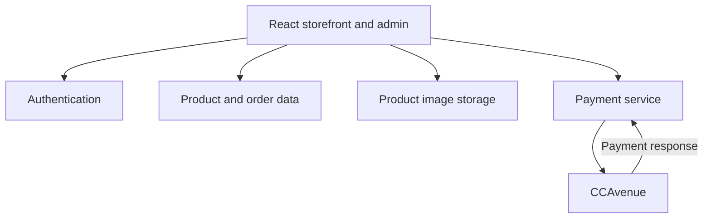

<div align="center">


# GCMT Shop

### Herbal commerce, from product discovery to order management.

A React storefront and administration workspace for **GCMT Herbal / Gold Coin Multi-Trade Private Limited**.


[Features](#features) · [Technology](#technology) · [Getting Started](#getting-started) · [Deployment](#deployment)

</div>

---

## Overview

GCMT Shop combines a customer shopping experience with dedicated tools for store administration. Customers can explore herbal and dental-care products, read product information, manage their cart, initiate online checkout, and view order records. Store administrators can maintain catalog content, manage orders, review customer enquiries, and export subscriber records.

The application uses **React, JavaScript, React Router, and custom CSS**, with Supabase for authentication, data access, and product-image storage. Online checkout integrates with CCAvenue through a separately configured payment service.

## Features

### Customer experience

| Area | Capabilities |
| --- | --- |
| Product discovery | Homepage product highlights and a database-backed product catalog. |
| Product information | Image galleries, pricing and discount displays, size selection, descriptions, benefits, ingredients, and usage instructions. |
| Shopping cart | Add products, adjust quantities, remove items, and review totals. |
| Quick checkout | “Buy Now” adds an item to the cart and opens checkout. |
| Customer accounts | Email/password registration and login, profile information, and session persistence. |
| Online checkout | Shipping/contact details, form validation, order creation, and CCAvenue payment initiation. |
| Order history | Customer order records, payment and fulfilment status displays, order detail dialogs, and downloadable PDF invoices. |
| Product reviews | Star ratings and written reviews, with controls for customers to manage their own reviews. |
| Contact and newsletter | Customer enquiry submissions and newsletter signup through the shared footer. |
| Content pages | Company information, FAQs, policies, and a static blog listing with category and text filters. |
| Responsive interface | Mobile navigation, adaptable layouts, loading states, toast notifications, and animations. |
| Page metadata | Metadata on selected pages, FAQ structured data, sitemap, and robots file. |

### Store administration

| Workspace | Capabilities |
| --- | --- |
| Product management | Create, edit, search, and delete products; maintain descriptions, prices, discounts, sizes, ingredients, and usage information. |
| Product images | Upload multiple product images using file selection or drag and drop. |
| Order management | Search and filter orders, inspect order details, update fulfilment statuses, and manage selected records. |
| Payment records | View payment statuses and manage payment records for existing cash-on-delivery orders. |
| Newsletter subscribers | Search and filter subscribers, view summary statistics, manage records, and export results to CSV. |
| Contact enquiries | Search submissions, view message details, manage records, and export results to CSV. |

The customer checkout currently offers online payment. Administration of existing cash-on-delivery records is a separate capability.

## Technology

| Layer | Tools |
| --- | --- |
| User interface | React, React DOM, JavaScript/JSX |
| Routing | React Router DOM |
| State | React hooks and Context |
| Authentication and data | Supabase Auth and Supabase JavaScript client |
| Product images | Supabase Storage |
| Payments | CCAvenue and a separately configured payment service |
| PDF invoices | html2canvas and jsPDF |
| Styling | Custom CSS and CSS Modules |
| Icons | Lucide React |
| Page metadata | react-helmet-async |
| Build tooling | Create React App / react-scripts |
| Test tooling | Jest through react-scripts and React Testing Library |
| Additional server-side source | TypeScript/Deno Edge Function |

Dependency declarations and resolved versions are maintained in `package.json` and `package-lock.json`.

## Architecture



The application contains customer pages, shared interface components, and dedicated administration screens. Supabase provides the connected authentication, database, and storage services. Payment-service deployment and merchant configuration are managed separately from the frontend.

## Getting Started

### Prerequisites

- **Node.js 20 or newer**, meeting the minimum requirement of the locked router dependency.
- **npm** and **Git**.
- An approved development Supabase environment with the application's data model, access policies, and image storage.
- A separately configured test payment service when developing checkout functionality.

### 1. Clone and install

```bash
git clone https://github.com/gcmt1/gcmt-vercel-webiste-vedpatel-project.git
cd gcmt-vercel-webiste-vedpatel-project
npm ci
```

The repository's `.npmrc` supplies the dependency-resolution settings used by this project.

### 2. Prepare development services

Before starting the application, have the maintainer configure the frontend to use the approved development services. Use development accounts and test records for local work.

This repository contains application source and service configuration, rather than a complete backend provisioning package. Database provisioning, access policies, merchant settings, and payment-service configuration require a separate setup. Obtain those instructions through the maintainer's approved private channel.

A local frontend server can still connect to remote services. Confirm that the application points to the intended development environment before using forms, accounts, or checkout.

### 3. Start the application

```bash
npm start
```

Open [http://localhost:3000](http://localhost:3000). The development server reloads the application as source files change.

## Project Structure

| Path | Purpose |
| --- | --- |
| `public/` | HTML entry point, public branding, manifest, sitemap, and robots file. |
| `src/App.jsx` | Application providers, shared layout, and routing. |
| `src/components/` | Navigation, footer, product cards, reviews, cart controls, notifications, and invoice generation. |
| `src/hooks/` | Reusable application hooks. |
| `src/pages/` | Storefront, customer, checkout, payment, and administration screens. |
| `src/styles/` | Page-specific styling and CSS Modules. |
| `src/assets/` | Logos, product images, promotional artwork, and marketing video. |
| `supabase/` | Local service configuration and additional server-side source. |
| `vercel.json` | Frontend hosting configuration. |

## Available Commands

| Command | Purpose |
| --- | --- |
| `npm start` | Start the local development server. |
| `npm run build` | Generate the production frontend in `build/`. |
| `npm test` | Launch the configured test runner in watch mode. |
| `npm test -- --watchAll=false` | Run the configured tests once. |

A successful build or test run is a development check; it does not establish the security of a deployed environment.

## Deployment

The frontend can be configured on Vercel using these build settings:

| Setting | Value |
| --- | --- |
| Project root | Repository root |
| Framework preset | Create React App |
| Install command | `npm ci` |
| Build command | `npm run build` |
| Output directory | `build` |

The repository includes a single-page application rewrite for client-side navigation. Connected services and payment processing require separate environment-specific configuration.

When adapting the project for another domain, review the website metadata, sitemap, analytics settings, authentication redirects, and service configuration before publication.

## Contributing and Security

- Use approved development services and test data for contributions.
- Keep credentials, merchant secrets, customer records, and private configuration out of commits, screenshots, and public discussions.
- Keep privileged service credentials on the server and review access policies as part of backend changes.
- Coordinate security reports privately with the maintainer. Avoid publishing sensitive findings or reproduction details in public issues or pull requests.

## Repository

Source and project updates: [gcmt1/gcmt-vercel-webiste-vedpatel-project](https://github.com/gcmt1/gcmt-vercel-webiste-vedpatel-project).
