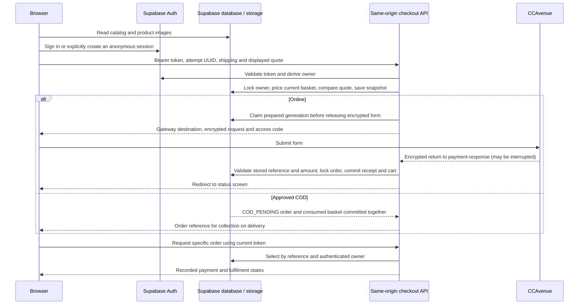

# Checkout and payment lifecycle

This describes the isolated implementation. The commercial storefront served a different checkout bundle on November 23, 2026. See the [deployment evidence](engineering-audit.md).

## Pricing and ownership

The browser sends its displayed lines and total in paise. The handler rejects extra authority fields and takes the owner from Supabase Auth. The database locks the profile, cart and matching products, calculates discounted unit paise, checks quantity/size/availability and compares the complete line set. A price or size substitution that preserves the total still invalidates the quote. A valid checkout snapshots the product name, row ID, variant, unit amount and line amount in the order. The current model uses INR and has no separate delivery or tax amount. There is no inventory reservation across customers. See `server/checkout.js` and `open_store_checkout` in the integrity migration.

## Recovery decisions

| Last server evidence | Next explicit customer action | Permitted outcome |
| --- | --- | --- |
| Validation failed, empty cart or changed quote | Reload cart, confirm shipping and price again | No payable order was released. |
| Prepared generation exists | Explicitly choose online payment again | Recheck the cart and shipping. Reuse the order ID, replace the prepared snapshot and invalidate the older generation. Only the latest generation can release a form. |
| Generation claimed, HTTP response lost, form submission interrupted, browser closed or gateway return missing | Check order history or submit checkout again | Return the existing owner reference. A lost response is indistinguishable from a delivered form. The server sends no further payable form for this unresolved attempt. |
| Recorded failure, including an abort | Check the recorded status | Keep the basket and block another payable attempt until independent evidence establishes the first is nonpayable. Delayed success can still arrive. |
| Approved merchant inquiry confirms final non-payability | Authorized operator records the merchant case using the restricted closure function | A new customer-initiated checkout may proceed. A contradictory late success enters review. |
| Successful payment persisted before browser return | Open order history or the owner-specific confirmation | Read the committed order. Settlement and cart consumption do not depend on viewing the success screen. |
| COD response lost | Check order history; a repeat of the same COD reference returns the existing order | No payment form. The order, unpaid status and removal of the purchased basket commit together. |

A tab retains a per-owner, per-method attempt UUID in session storage until it receives a usable response. The per-owner lock also covers different tabs and independently generated references. A guest who loses the anonymous Supabase identity needs private support and proof of ownership. The public reference alone grants no access.

## Callback decisions

`server/ccavenue.js` implements the candidate merchant encoding. `server/payment.js` accepts one bounded encrypted form response, rejects repeated critical fields and requires the configured merchant, INR, a recognized final state and a tracking reference for success. `record_store_response` binds the exact wire reference to the stored order. Older UUID orders can use their original reference. New orders use `server/reference.js` to encode their UUID. The approved merchant kit must confirm this field contract, including whether the merchant ID is actually returned. If it is omitted, the candidate refuses the callback. Obtain authoritative merchant inquiry evidence before recording payment in that situation.

| Evidence received | Atomic database result |
| --- | --- |
| First matching success | One unique receipt, order paid, pending fulfilment confirmed, exact purchased cart rows reconciled and event appended. |
| Identical repeat | Duplicate disposition, no second consumption. |
| Failure, abort or invalid status reported as final by the gateway | FAILED payment, basket retained. An unknown/nonfinal gateway status is rejected by the parser. |
| Failure followed by matching success | Upgrade only with the prior failure receipt and compatible tracking evidence. Preserve a distinct existing fulfilment state. |
| Wrong amount, reused tracking ID, changed terminal evidence, success after operator closure | Reject or record for review. No automatic downgrade or second charge. |
| Persistence error | The transaction rolls back. A repeated authentic callback can then be recorded. |
| Legacy snapshot with no cart row identity | Record the financial result and preserve the current basket. Support may need to help clear old items. |

The private review view exposes unresolved orders and recorded conflicts. Attempts rejected before an order can be identified do not produce an order event. Diagnosis should use timestamps, opaque references, HTTP status counts and sanitized request IDs. Keep billing data, tokens, ciphertext and credentials out of logs. Do not equate the latest event with resolution of an earlier conflict.

`server/reconciliation.js` provides a bounded batch with database claims, leases and backoff for an injected authenticated status-inquiry transport. No merchant transport, scheduler or reconciliation service is installed. Without merchant evidence, an unresolved attempt can remain blocked. Neither the local cipher round trip nor a simulator redirect demonstrates gateway acceptance or receipt authenticity in production.

## Cash on delivery and invoices

Storefront visibility and server permission each default off. An approved COD request uses the same validated quote and owner lock, creates a COD_PENDING/PROCESSING order and returns an owner lookup. Only an authenticated administrator can collect an eligible order and must supply a receipt reference. Collection records the actor and cash action separately from gateway receipts. Existing COD history retains its payment method after collection. Owner approval is required for eligibility, availability and the operational collection procedure.

Customer history and the confirmation screen label a missing recorded amount as unavailable. A cancelled COD order carries no active delivery estimate or cash-due prompt. Customer PDFs use the recorded order total and check the item arithmetic before rendering. The snapshot has no separate tax breakdown. Older inconsistent records require finance review. Confirm tax, rounding, freight, invoice numbering, refunds and retention with the business before issuing production invoices.
